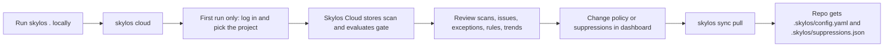

Skylos is local-first. The CLI does the analysis on your machine or in CI. **Skylos Cloud** is the hosted layer that stores scan results, applies shared project policy, tracks issues over time, and gives your team one place to review and act.

## Start Here: `skylos cloud`

To use Skylos Cloud, you need one command:

```bash
skylos cloud
```

`skylos cloud` runs every check (`-a`), shows the findings, uploads them to
Skylos Cloud, then prints this branch's quality gate and one link to it.

- First run: it opens your browser to log in and pick the project for this repo.
- Checks: every check (`-a`), unless you name some.
  `skylos cloud --danger --secrets` runs only those.
- Sends: findings with file paths and code snippets of up to 7 lines (none for
  secrets), the branch, the commit, the git author email of each flagged line,
  and a map of your functions and classes (names, files, lines, sizes, which
  calls which). Not your repository.
- Exit code: 0 even when the gate fails. Add `--gate` to exit 1 on a failed
  gate (use this in CI).
- Takes the same scan flags as `skylos .`, e.g. `skylos cloud src --exclude build`.
- No terminal and no login: it stops before scanning and exits 1 with
  "Not connected to Skylos Cloud. Run skylos login in a terminal, or set
  SKYLOS_TOKEN to a project token (create one in your project's Settings on
  skylos.dev)." In GitHub Actions or GitLab CI it uses the CI identity (OIDC)
  or `SKYLOS_TOKEN`.

### What You See

`skylos cloud` prints the findings tables, like `skylos . -a`, then the gate
for this branch.

Failed gate on a branch:

```text
✗ Quality gate on feat/login: FAILED (was PASSED on 24 Oct 15:38 UTC, 1ba9895) · 1 critical security issue
  Open: https://skylos.dev/dashboard/projects/<project>?branch=feat%2Flogin
  Next: fix the issues behind the failed gate, then run skylos cloud again.
```

The issues are in the findings tables printed above these lines.

Passed gate on main, no CI yet:

```text
✓ Quality gate on main: PASSED (was FAILED on 24 Oct 15:38 UTC, 1ba9895)
  Open: https://skylos.dev/dashboard/projects/<project>
  Next: skylos cicd init — adds a Skylos check to every pull request.
```

When you upload `main` from your laptop with your `skylos login` token, one
more line says the upload is unverified: it is shown in Skylos Cloud but does
not set the project verdict or mark issues fixed.

The link opens the project Overview for that branch: the gate, why it failed,
and how it changed since the last run.

### Use It In CI

```bash
skylos cloud --gate
```

`--gate` makes the command exit 1 when the Skylos Cloud gate fails, so the CI
job fails too. That gate is your project's policy in Skylos Cloud.
`skylos . --gate` is a different, local gate: it uses the limits in your
`[tool.skylos.gate]` config and uploads nothing.

Set `SKYLOS_TOKEN` to a project token in CI systems without OIDC. In the
project's Settings, select **Mark for CI** on that token. Uploads with an
unmarked token are unverified: they show in Skylos Cloud, but they don't
publish a check or mark issues fixed. Never mark a token that is on a
developer machine.

Skylos Cloud does not accept GitHub OIDC uploads from ordinary `pull_request`
jobs. For a check on every GitHub pull request, use the workflow from
`skylos cicd init`. See [CI/CD Integration](/ci-cd).

### The Manual Form: `--upload`

```bash
skylos . --danger --secrets --upload
```

`--upload` on a scan is the manual form of `skylos cloud`: it uploads exactly
the checks you picked.

## Which Commands Talk To Skylos Cloud

You only need `skylos cloud`. The rest are for control:

| Command | Use it to |
|:---|:---|
| `skylos cloud` | scan, upload, see the gate (the one to remember) |
| `skylos login` | switch to another project |
| `skylos whoami` | see which account and project you are connected to |
| `skylos project <command>` | manage the project linked to this repo |
| `skylos upload --retry` | resend uploads that did not finish |
| `skylos sync` | pull the project's Cloud policy into the repo |
| `skylos credits` | check your credit balance |
| `--upload` on a scan | the manual form of `skylos cloud`: uploads exactly the checks you picked |

Scans never upload unless you run `skylos cloud` or add `--upload`. For every
network request the CLI can make, see
[What leaves your machine](https://github.com/duriantaco/skylos/blob/main/docs/privacy-and-network.md).

## Do I Need A Key To Pass The Gate?

No. A token only lets you upload. The gate passes when the issues that fail it
are fixed. On the Workspace and Enterprise plans, a workspace admin or owner can
override a failed gate in Skylos Cloud (Merge anyway); they must give a reason, and it is
recorded with the scan.

## More Cloud Guides

If you want the full repo-to-dashboard flow, read:

- [CLI to Dashboard Workflow](/cloud-workflow)
- [Authentication](/authentication)
- [Enterprise Trust](/enterprise-trust)
- [CI/CD Integration](/ci-cd)

:::tip New Users
Your first workspace gets a 14-day Workspace trial with 50 credits, and no card. You can start with `skylos cloud` and add deeper GitHub integration later.
:::

## Use Local Only vs Add Cloud

| If you want... | Use this |
|---|---|
| Local scan only | `skylos .` |
| Local security, secrets, quality, and AI-defect checks | `skylos . --danger --secrets --quality --ai-defects` |
| Local exit-code enforcement only | `skylos . --gate` |
| Upload a scan and see this branch's gate | `skylos cloud` |
| Switch this repo to another cloud project | `skylos login` |
| Upload only some checks | `skylos cloud --danger --secrets` |
| Compare Skylos with an existing scanner without replacing its gate | `skylos compare . --against incumbent.sarif --upload` |
| Pull project policy and suppressions into the repo | `skylos sync pull` |
| Inspect which project this repo is linked to | `skylos project status` |

Stay local when you only need a fast developer or CI scan.

Add the cloud when you need:
- scan history
- shared suppressions
- project policy managed in the dashboard
- issues and exception workflows
- trends across branches and time
- GitHub-native features such as OIDC, the GitHub App, deep links, or PR checks

## What Cloud Adds

### Workspace Views

Skylos Cloud currently gives you workspace-level navigation for:
- `Overview`
- `Projects`
- `Scans`
- `Issues`
- `Exceptions`
- `Rules`
- `Trends`

### Project Views

Each project currently has tabs for:
- `Overview`
- `Scans`
- `Issues`
- `Suppressions`
- `Defense`
- `Provenance`
- `Scanner proof`
- `Settings`

The **Scanner proof** tab stores bounded, tamper-evident comparison receipts from `skylos compare --upload`. Use it to evaluate Skylos beside an incumbent scanner on the same revision before changing a required gate. See [Scanner Comparison](/scanner-comparison).

### Project Settings

`Dashboard -> Settings` is the project-management surface for:
- repository URL
- API key rotation
- GitHub App installation
- Slack and Discord notifications
- team members
- workspace/project policy
- policy inheritance

### Enterprise Trust Controls

Skylos Cloud also provides the current trust foundations needed for a security-team pilot:

- role-based workspace access
- project API keys and GitHub OIDC upload paths
- server-side upload attribution
- audit events for mutating governance workflows
- audit export foundations
- project policy and suppression governance

For the full buyer-facing view, including what exists today and what remains on the enterprise roadmap, see [Enterprise Trust](/enterprise-trust).

## How the Cloud Fits the CLI



The split is simple:
- **CLI:** analysis happens here
- **Cloud:** history, policy, suppressions, grouping, and team workflows happen here

## Repo URL: Optional vs Required

A project can stay cloud-only and still accept normal API-key uploads.

Set the project `repo_url` when you want:
- GitHub Actions OIDC uploads
- GitHub App installation
- GitHub deep links in the dashboard
- PR-linked GitHub check runs or comments
- repo-aware default-branch behavior

That distinction matters. Basic uploads do **not** require a GitHub repo binding. GitHub-native automation does.

## What Data Gets Sent

When you upload a scan with `skylos cloud` or `--upload`, Skylos Cloud receives analysis results and metadata, not your repository contents.

| Sent | Not sent |
|---|---|
| finding details | source code files |
| file paths | full repository contents |
| line numbers | secrets from your environment |
| code snippets of up to 7 lines (none for secrets) | your `.env` files as raw uploads |
| branch / commit metadata | your git history as source blobs |
| git author email of each flagged line | |
| a map of your functions and classes (names, files, lines, sizes, which calls which) | |
| summary counts and gate data | |

Uploaded findings can include security-sensitive metadata and contextual evidence needed to explain results. Treat cloud scan results as sensitive security data even though Skylos does not upload the full repo as source blobs during normal scan upload.

Scanner-comparison receipts are narrower than normal scan uploads: scanner messages, source snippets, fingerprints, and absolute local paths remain local. Cloud receives aggregate evidence and repository-relative review metadata only.

## Next Step

For the complete end-to-end flow from `skylos` to `skylos-cloud`, read [CLI to Dashboard Workflow](/cloud-workflow). That guide covers login, upload, policy sync, repo URL requirements, CI, and the difference between local vs cloud gating.
