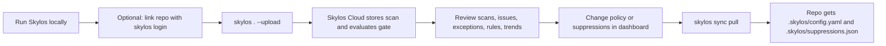

Skylos is local-first. The CLI does the analysis on your machine or in CI. **Skylos Cloud** is the hosted layer that stores scan results, applies shared project policy, tracks issues over time, and gives your team one place to review and act.

If you want the full repo-to-dashboard flow, read:

- [CLI to Dashboard Workflow](/cloud-workflow)
- [Authentication](/authentication)
- [Enterprise Trust](/enterprise-trust)
- [CI/CD Integration](/ci-cd)

:::tip New Users
Every new account gets **50 starter credits** and a **7-day Pro trial**. You can start with `skylos . --upload` and add deeper GitHub integration later.
:::

## Use Local Only vs Add Cloud

| If you want... | Use this |
|---|---|
| Local scan only | `skylos .` |
| Local security, secrets, quality, and AI-defect checks | `skylos . --danger --secrets --quality --ai-defects` |
| Local exit-code enforcement only | `skylos . --gate` |
| Connect this repo to a cloud project | `skylos login` |
| Upload a scan to the dashboard | `skylos . --upload` |
| Compare Skylos with an existing scanner without replacing its gate | `skylos compare . --against incumbent.sarif --upload` |
| Pull project policy and suppressions into the repo | `skylos sync pull` |
| Inspect which project this repo is linked to | `skylos project status` |

Stay local when you only need a fast developer or CI scan.

Add the cloud when you need:
- scan history
- shared suppressions
- project policy managed in the dashboard
- issues and exception workflows
- trends across branches and time
- GitHub-native features such as OIDC, the GitHub App, deep links, or PR checks

## What Cloud Adds

### Workspace Views

The workspace sidebar is grouped by job:
- **Code:** `Home`, `Pull requests`, `Issues`
- **AI agents:** `Agents` (when agent checks are on) and `Deep scans` (when available)
- **Governance:** `Policy`, `Not fixing`, `Audit evidence`
- **Workspace:** `Settings`, `Billing`

### Pull Requests Board

`Pull requests` has two layouts. **List** answers "can this pull request merge?" row by row. **Board** shows whose turn each pull request is, in five columns:

| Column | What it means | Who acts |
|---|---|---|
| Scanning | A new commit was pushed, or its upload has not finished | Nobody yet; the card moves by itself |
| Needs fixes | The quality gate or an agent check failed, or a reviewer asked for changes | The author pushes a fix |
| Needs approval | The gate passed and only a protected-path sign-off is left | A member of the team that owns the path |
| Ready to merge | The Skylos check is green on GitHub | The author merges on GitHub |
| Merged | Merged in the last 7 days | Nobody |

Click a card to open it. If you can approve, tick the protected paths you accept, write a note, and click **Approve selected**. Each approval is recorded in the audit log, covers that commit only, and re-publishes the Skylos check, which turns green once nothing else blocks. The author of a pull request, and anyone who committed to it, cannot approve it.

**Request changes** saves your note against the current commit, posts it on the pull request on GitHub, and moves the card to **Needs fixes** until a new commit is scanned. It does not change the Skylos check. Viewers can open cards but cannot approve or request changes.

**Waiting on you** narrows the board to the pull requests you can approve and the ones you opened that need fixes. Titles, merges, closed pull requests and new pushes come from the Skylos GitHub App; without it, cards use the branch name.

### Project Views

Each project has tabs for:
- `Overview`
- `Issues`
- `Pull requests` (with the same List and Board layouts, for this project only)
- `Scans`
- `Settings`

The project's **More** menu holds Trends, Code attribution, AI feature safeguards, Agent PR log, Technical debt, Investigate, Required controls and Not fixing.

The **Scanner proof** page under Scans stores bounded, tamper-evident comparison receipts from `skylos compare --upload`. Use it to evaluate Skylos beside an incumbent scanner on the same revision before changing a required gate. See [Scanner Comparison](/scanner-comparison).

### Project Settings

`Dashboard -> Settings` is the project-management surface for:
- repository URL
- API key rotation
- GitHub App installation
- Slack and Discord notifications
- team members
- workspace/project policy
- policy inheritance

### Enterprise Trust Controls

Skylos Cloud also provides the current trust foundations needed for a security-team pilot:

- role-based workspace access
- project API keys and GitHub OIDC upload paths
- server-side upload attribution
- audit events for mutating governance workflows
- audit export foundations
- project policy and suppression governance

For the full buyer-facing view, including what exists today and what remains on the enterprise roadmap, see [Enterprise Trust](/enterprise-trust).

## How the Cloud Fits the CLI

The split is simple:
- **CLI:** analysis happens here
- **Cloud:** history, policy, suppressions, grouping, and team workflows happen here

## Repo URL: Optional vs Required

A project can stay cloud-only and still accept normal API-key uploads.

Set the project `repo_url` when you want:
- GitHub Actions OIDC uploads
- GitHub App installation
- GitHub deep links in the dashboard
- PR-linked GitHub check runs or comments
- repo-aware default-branch behavior

That distinction matters. Basic uploads do **not** require a GitHub repo binding. GitHub-native automation does.

## What Data Gets Sent

When you upload a scan, Skylos Cloud receives analysis results and metadata, not your repository contents.

| Sent | Not sent |
|---|---|
| finding details | source code files |
| file paths | full repository contents |
| line numbers | secrets from your environment |
| branch / commit metadata | your `.env` files as raw uploads |
| summary counts and gate data | your git history as source blobs |

Uploaded findings can include security-sensitive metadata and contextual evidence needed to explain results. Treat cloud scan results as sensitive security data even though Skylos does not upload the full repo as source blobs during normal scan upload.

Scanner-comparison receipts are narrower than normal scan uploads: scanner messages, source snippets, fingerprints, and absolute local paths remain local. Cloud receives aggregate evidence and repository-relative review metadata only.

## Next Step

For the complete end-to-end flow from `skylos` to `skylos-cloud`, read [CLI to Dashboard Workflow](/cloud-workflow). That guide covers login, upload, policy sync, repo URL requirements, CI, and the difference between local vs cloud gating.
