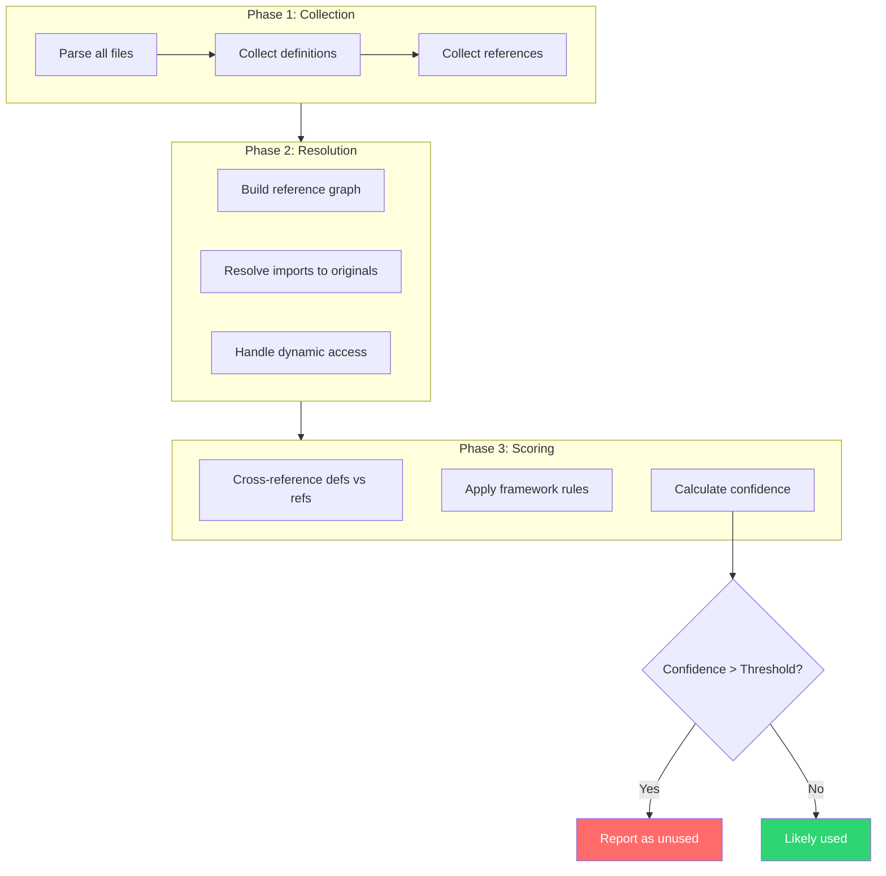
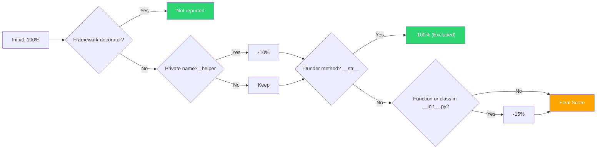
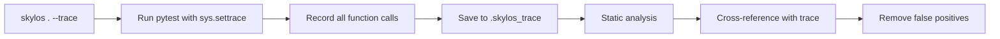

import Tabs from '@theme/Tabs';
import TabItem from '@theme/TabItem';

## The Hidden Cost of Dead Code

Dead code isn't just clutter. It's **active technical debt** that:

- **Slows Development** - Developers read and reason about code that does nothing
- **Hides Bugs** - Unused code paths can mask logic errors and security issues
- **Increases Attack Surface** - Vulnerable code that's "not used" can still be exploited
- **Bloats Bundles** - Unused imports increase load times and memory usage

**The problem?** Removing code is scary. What if it's actually used somewhere you didn't check?

---

## How Skylos Finds Dead Code

Skylos builds a complete **reference graph** of your codebase, then identifies definitions with zero references.


### What Gets Detected

| Category | Rule | Example | Detection Method |
|----------|------|---------|------------------|
| **Unused functions** | `SKY-U001` | `def helper(): ...` never called | No call references found |
| **Unused imports** | `SKY-U002` | `import json` but `json` never used | No name references found |
| **Unused variables** | `SKY-U003` | `result = compute()` but `result` never read | Assigned but never referenced |
| **Unused classes** | `SKY-U004` | `class OldModel: ...` never instantiated | No instantiation or inheritance |
| **Unused parameters** | `SKY-U006` | `def fn(a, b): return a` | Parameter `b` never used in body |
| **Unused files** | `SKY-E003` | A TypeScript/JavaScript file nothing imports | No import of the file found |

Unreachable code (`SKY-UC001`, `SKY-UC002`) and unused dependencies
(`SKY-U005`) are dead-code findings too, but they only run with `--quality`.

Unused parameters are capped at confidence 50, so they are hidden at the
default threshold of 60. Use `--confidence 40` to see them.

### Languages

Coverage is not the same in every language:

| Language | What dead-code detection covers |
|----------|---------------------------------|
| Python | Deepest support: functions, classes, imports, variables, parameters, framework rules |
| TypeScript / JavaScript | Functions, classes, imports, unused files (`SKY-E003`), unnecessary exports (`SKY-E004`) |
| Java, Go, PHP | Unused symbols; Go needs the bundled `skylos-go` engine |
| Kotlin | Private symbols and imports only |
| Rust | Experimental. Findings are capped at confidence 40, so they are hidden at the default threshold of 60. Use `--confidence 40` to see them |
| Dart | Needs `pip install "skylos[dart]"` |
| C# | Partial |
| C++ | File-local functions only |

See [Language Support](/language-support) for details.

---

## The Confidence System

Not all "unused" code is actually dead. A helper function might be:

- Called dynamically via `getattr()`
- Used by a framework implicitly
- Part of a public API

Skylos assigns a **confidence score** (0-100) to each finding, so you can filter out uncertain results.


### Confidence Penalties

| Pattern | Penalty | Reason |
|---------|---------|--------|
| Private name (`_foo`, Python) | -10 | Convention for internal use |
| Dunder (`__str__`) | -100 | Called implicitly by Python |
| Underscore var (`_`) | Not reported | Intentionally unused |
| Function or class in `__init__.py` | -15 | Often public API re-exports |
| Framework decorator (route, signal, fixture) | Not reported | Called by the framework |
| Dynamic module | -10 | May use `getattr()` |
| Test decorator | -100 | Called by test runner |

### Confidence Caps

Some findings can never reach 100%, because the code may still be used from
outside the scan:

| Finding | Highest confidence |
|---------|--------------------|
| Public Python function, class or variable | 90 |
| Exported but never imported | 85 |
| Public method (dynamic dispatch possible) | 80 |
| Class attribute (frameworks may read it) | 80 |
| File no import loads | 80 |
| Only reachable through a dynamic lookup | 70 |
| Default export | 60 |
| Parameter | 50 |
| Rust (experimental) | 40 |
| Deprecated API kept for callers | 40 |

The report shows the reason next to the score, for example
`Confidence: 90% (public name)`.

### Using Confidence Threshold
```bash
# Default: only findings with ≥60% confidence
skylos .

# Include more uncertain findings
skylos . --confidence 40

# Only high-confidence findings
skylos . --confidence 80
```

---

## Framework Awareness

Skylos understands that framework code is called implicitly:

<Tabs>
  <TabItem value="django" label="Django" default>
```python
# Not flagged - Django calls this via URL routing
def user_detail(request, pk):
    return render(request, 'user.html', {'user': User.objects.get(pk=pk)})

# Not flagged - Signal receiver
@receiver(post_save, sender=User)
def create_profile(sender, instance, **kwargs):
    Profile.objects.create(user=instance)

# Not flagged - Class-based view methods
class UserView(View):
    def get(self, request):
        return HttpResponse("Hello")
```

  </TabItem>
  <TabItem value="flask" label="Flask / FastAPI">
```python
# Not flagged - Route handler
@app.route('/users')
def get_users():
    return jsonify(users)

# Not flagged - Error handler
@app.errorhandler(404)
def not_found(e):
    return "Not found", 404

# Not flagged - FastAPI dependency
async def get_db():
    db = SessionLocal()
    try:
        yield db
    finally:
        db.close()
```

  </TabItem>
  <TabItem value="pydantic" label="Pydantic">
```python
# Not flagged - Pydantic model
class UserCreate(BaseModel):
    name: str
    email: str

# Not flagged - Validator
@field_validator('email')
def validate_email(cls, v):
    if '@' not in v:
        raise ValueError('Invalid')
    return v
```

  </TabItem>
  <TabItem value="pytest" label="Pytest">
```python
# Not flagged - Fixture
@pytest.fixture
def db_session():
    return create_session()

# Not flagged - Test function
def test_user_creation(db_session):
    user = User(name='Test')
    assert user.name == 'Test'
```
  </TabItem>
</Tabs>

---

## Custom Entrypoints

For proprietary frameworks, plugin loaders, and decorator registries, add
project-specific entrypoint rules instead of broad whitelists:

```toml
[[tool.skylos.dead_code.entrypoints]]
type = "method"
name = ["create", "pre_hook", "post_hook"]
parent = { name = "Main", base_classes = ["Application"] }
reason = "project framework lifecycle hook"

[[tool.skylos.dead_code.entrypoints]]
type = "function"
decorators = ["runtime_hook"]
path = "src/**"
reason = "registered by runtime_hook"
```

Skylos treats matching definitions as live while still reporting unrelated
dead code in the same files. See [Configuration](/configuration) for every
supported match field. Entrypoint rules must include a symbol selector such as
`name`, `decorators`, `base_classes`, or `parent`; `path`, `module`, and
`type` only narrow the match.

---

## Smart Tracing (Runtime Analysis)

Static analysis can't catch everything. When code is called dynamically via `getattr()`, visitor patterns, or reflection, Skylos may flag it as unused.

**The solution:** Run your tests with call tracing enabled.
```bash
skylos . --trace
```

This:
1. Runs your test suite with `sys.settrace()` enabled
2. Records every function that was actually called
3. Uses that data to eliminate false positives

### What Gets Captured

| Pattern | Static Analysis | With `--trace` |
|---------|----------------|----------------|
| `visitor.visit(node)` → `visit_FunctionDef()` | Missed | Caught |
| `getattr(obj, "method")()` | Missed | Caught |
| Plugin hooks (`pytest_configure`) | Missed | Caught |
| Reflection / dynamic imports | Missed | Caught |

### When to Use `--trace`

**Use It:**
- Projects with visitor patterns (AST, CST)
- Plugin architectures
- Heavy use of `getattr()` / reflection
- Many false positives from static analysis

**Skip It:**
- Simple codebases with direct calls
- No test suite available
- CI where speed matters (tracing adds overhead)

### How It Works


:::tip
**Tip:** Commit `.skylos_trace` to your repo if your test suite is stable. Then `skylos .` will use it automatically without re-running tests.
:::

---

## Comparison: Why Not Just Use Your IDE?

| Feature | IDE "Unused" Warning | Skylos |
|---------|---------------------|--------|
| Cross-file analysis | No, single file | Yes, entire codebase |
| Framework awareness | No | Yes: Django, Flask, FastAPI, Pydantic and more |
| Confidence scoring | No | Yes, filter uncertain findings |
| CI/CD integration | No | Yes, block PRs and write reports |
| Batch removal | No | Yes, interactive selection (Python) |
| Import tracking | Basic | Yes, resolves re-exports |

---

## Safe Removal Workflow

### 1. Scan with high confidence

Start with findings you can trust:
```bash
skylos . --confidence 80
```

### 2. Preview deterministic cleanup

For Python unused import/function cleanup, preview the exact edits first:

```bash
skylos clean . --dry-run --types import,function --confidence 80
```

### 3. Apply selected cleanup

Apply the same deterministic cleanup without prompts:

```bash
skylos clean . --apply --types imports --confidence 80
```

Use comment-out mode when you want a reversible source marker:

```bash
skylos clean . --apply --comment-out --types import,function --confidence 80
```

`skylos clean` edits Python unused imports and unused functions only. It
skips other finding types and other languages, and uses Python LibCST
codemods rather than regex edits. With no mode flag, it interactively selects
edits and can write after final confirmation. `--dry-run` never writes. A
completed apply pass can still exit `0` after printing an individual transform
failure, so review its completion output.

### 4. Review in interactive mode

Select what to remove. Interactive mode needs an interactive terminal, so it
does not run in CI:
```bash
skylos . -i --dry-run
```

### 5. Remove or comment out interactively
```bash
# Delete selected items
skylos . -i

# Or comment out (safer)
skylos . -i --comment-out
```

### 6. Run tests

Verify nothing broke:
```bash
pytest
```

### Comment-Out Mode

Instead of deleting, Skylos can comment out code with a marker:
```python
# Before
def unused_helper():
    return "I'm not used"

# After --comment-out
# SKYLOS DEADCODE: def unused_helper():
# SKYLOS DEADCODE:     return "I'm not used"
```

Search for `SKYLOS DEADCODE` later to permanently remove or restore.

---

## Output Formats

<Tabs>
  <TabItem value="table" label="Table (Default)" default>
```
────────────────────────── Unused Functions ──────────────────────────
┏━━━━━━━━┳━━━━━━━━━━┳━━━━━━━━━━━━━━━━━┳━━━━━━━━━━━━━━━━━━━━━━━━━━━━━━━━┳━━━━━━━━━━━━┓
┃ Type   ┃ Severity ┃ Rule            ┃ Message                        ┃ Location   ┃
┡━━━━━━━━╇━━━━━━━━━━╇━━━━━━━━━━━━━━━━━╇━━━━━━━━━━━━━━━━━━━━━━━━━━━━━━━━╇━━━━━━━━━━━━┩
│ Review │ LOW      │ Unused function │ Unused function: unused_helper │ utils.py:5 │
│        │          │ SKY-U001        │ Confidence: 90% (public name)  │            │
│        │          │                 │ Evidence: likely dead — no     │            │
│        │          │                 │ static references were found   │            │
└────────┴──────────┴─────────────────┴────────────────────────────────┴────────────┘
```

| Column | Meaning |
|--------|---------|
| **Rule** | The finding type and rule ID |
| **Message** | The unused symbol, its confidence score (0–100%) and the evidence. Higher confidence is safer to remove |
| **Location** | `file:line` where it's defined |

Above the tables, the report shows a scan assessment (Risk, Maintainability,
Dead code, Gate) and a coverage line that says which checks did not run.

  </TabItem>
  <TabItem value="tree" label="Tree">
```bash
skylos . --tree
```
```
my-project
└── utils.py
    ├── L1 Type: Review  Severity: LOW
    │   SKY-U002 · Unused import
    │   Unused import: json
    │   Confidence: 100%
    └── L5 Type: Review  Severity: LOW
        SKY-U001 · Unused function
        Unused function: unused_helper
        Confidence: 90% (public name)
```

  </TabItem>
  <TabItem value="json" label="JSON">
```bash
skylos . --json -o report.json
```
```json
{
  "unused_functions": [
    {
      "name": "unused_helper",
      "full_name": "utils.unused_helper",
      "type": "function",
      "file": "/path/to/project/utils.py",
      "line": 5,
      "confidence": 90,
      "references": 0,
      "dead_code_classification": "likely_dead",
      "dead_code_evidence": [...]
    }
  ],
  "unused_imports": [...],
  "unused_classes": [...],
  "unused_variables": [...],
  "unused_parameters": [...],
  "unused_files": [...]
}
```

  </TabItem>
  <TabItem value="concise" label="Concise">
```bash
skylos --format concise src/test.py
```
```text
src/test.py:1  SKY-U001  unused function: old_handler
src/test.py:5  SKY-U004  unused class: OldModel
```

Concise output is designed for IDE terminals and scripts. It suppresses rich
tables, banners, progress text, tips, and CTAs. Clean scans print nothing and
exit `0`; scans with findings exit `1` unless `--force` is used.

  </TabItem>
</Tabs>

---

## Next Steps

- [Framework Awareness](/framework-awareness) - See all supported frameworks and patterns
- [CI/CD Integration](/ci-cd) - Automate dead code detection in your pipeline
