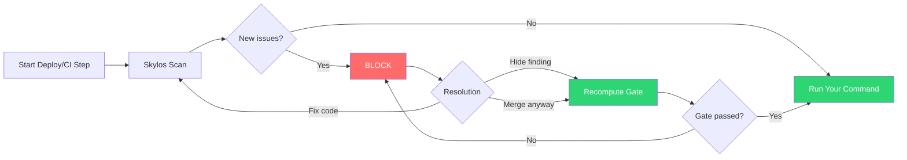

## What this is

The quality gate turns a scan into a pass or fail. Run it before a merge or a
deploy, and stop the step when the code gets worse.

```bash
skylos . -a --gate
```

The local gate fails on:

- any critical security finding
- any secret
- any critical AI defect
- counts above the limits in `[tool.skylos.gate]`

Exit codes: `0` PASSED, `1` FAILED, `2` INCOMPLETE (a requested check could not
finish).

Use it as a **ratchet** so old debt does not block you. Only the changes that
make things worse fail.

> "We ignore your existing 500 bugs. We only block you if you add Bug #501."

---

## Key concepts

### The Ratchet

The local gate counts every finding the scan reports. To count only new ones,
pick one of these:

```bash
# Save today's findings once, then report only new ones
skylos baseline .
skylos . -a --gate --baseline

# Report only findings on lines changed since main
skylos . -a --gate --diff origin/main
```

In Skylos Cloud, the policy on uploaded scans blocks new issues on the branch.

- **Legacy issues**: already existed → shown, but don't block
- **New issues**: introduced by your change → can block the gate

`--gate` only checks the analyzers you turned on. Without `-a` (or `--danger`,
`--secrets` and so on) it checks dead code only and prints that security was
not scanned.

### Governance actions

When a new issue appears, Skylos supports three resolution paths:

1. **Fix** (preferred): change code and re-run the scan
2. **Hide one finding**: mark it as a false positive or an accepted risk so it stops blocking. Locally, use an inline comment or `skylos review`. In Cloud, use **Not fixing**
3. **Merge anyway** (last resort, Cloud): pass one failed pull-request check with a logged reason

---

## Who does what (roles)

### Developer
- Runs Skylos locally before pushing
- Fixes issues when possible
- If blocked, opens the scan link to resolve (or escalates)

### Tech Lead / Security Lead
- Reviews *new* findings introduced by PRs
- Hides true false positives one by one, with a reason and an expiry
- Keeps "Merge anyway" rare and justified

### Owner / Admin
- Sets the workspace policy in **Governance → Policy**
- Requires the Skylos check on protected branches
- Reviews **Not fixing** decisions and the audit log

---

## Local CLI vs Skylos Cloud

The local gate is free and needs no account. Cloud adds a shared policy and a
pull-request check. Cloud plans are Free, Workspace and Enterprise.

| Capability | Local CLI | Cloud Free | Cloud Workspace / Enterprise |
|---|---|---|---|
| Ratchet | `skylos baseline` + `--baseline`, or `--diff` | Policy on uploads: block any new issue | Same, or allow a set number of new issues per category or severity |
| Blocking | CLI exits `1` and the CI step fails | Pass/fail check on pull requests | Same |
| Bypass | `--force` (local only, exits `0`) | None | **Merge anyway** with a reason, logged |
| Hide one finding | Inline comment or `skylos review` | **Not fixing**: false positive or accepted risk, 25 per project, expiry of 7, 30 or 90 days | **Not fixing** with approvals |
| Edit policy | `[tool.skylos.gate]` | Read-only policy | Edit policy, per-repository policies |

---

## The workflow (at a glance)

Run Skylos as a gate before your deploy/test command. If the scan fails, the
step exits non-zero and later CI steps do not run:
```bash
skylos . -a --gate
```


---

## Quickstart

### 1) Install
```bash
pip install skylos
```

### 2) Run locally (recommended before every push)
```bash
skylos . -a
```

`-a` turns on security, secrets, quality, AI defects and dependency CVEs.

### 3) Gate a command

Run the command only if the gate passes. Everything after `--` runs on PASSED:
```bash
skylos . -a --gate -- ./deploy.sh
```

---

## Release Reliability Gates

`--gate` evaluates the analyzers enabled in that invocation; it does not turn
every analyzer on by itself. `--danger` enables deployment/runtime contract
analysis as well as Security, while exact `--select` rules enable only the
families they need.

Reliability has an independent threshold, `max_reliability`, which defaults to
`0`. It does not consume `max_security` or alter the Security count.

```bash
# Prove the external Kubernetes deployment path
skylos . --select SKY-DEP001,SKY-DEP002,SKY-DEP003 --gate

# Check GPU source/build intent against the declared target fleet
skylos . --select SKY-GPU001,SKY-GPU002,SKY-GPU003 --gate
```

The GPU gate automatically retains `SKY-GPU000`. A missing, invalid, deleted,
or incomplete required GPU contract therefore blocks instead of silently
passing. See [Release Reliability](./release-reliability) for setup.

That rule gate does not inspect a built binary. After the build, run
`skylos preflight build/app`; its independent gate contract is exit `0` for
`PASS`, `1` for a proved incompatibility, and `2` for `UNKNOWN` or invalid
input.

---

## What a failure looks like

When the gate fails, Skylos prints why and exits `1`:
```text
 Quality Gate: FAILED
   • 1 critical security issue
       SKY-D211  app.py:9  Possible SQL injection: tainted or string-built query.
```

On an interactive terminal, a failed gate without `--strict` asks "Continue
anyway?". In CI there is no prompt; the step fails.

In Cloud, an uploaded scan that fails the policy fails the Skylos check on the
pull request. The check links to the scan page.

---

## How to resolve (the "adult" way)

### Option A — Fix the code (preferred)

1. Read the finding (file, line, rule ID)
2. Fix the code
3. Re-run:
```bash
skylos . -a --gate
```

4. Gate passes when nothing over the limits is left

### Option B — Hide one finding (False Positive / Accepted Risk)

Use this when the scanner is wrong *or* you accept the risk for a while.

**Locally**

* Add an inline comment on the line, for example
  `# skylos: ignore[SKY-D211] input is a constant`. See
  [Configuration](./configuration#inline-ignores).
* Or run `skylos review` to record a local decision. Local review decisions
  are ignored in CI.

**In Skylos Cloud**

1. Open the issue from the scan page
2. Choose **Not fixing**
3. Pick **False positive** or **Accepted risk**, and add a reason
4. On Free, pick an expiry of 7, 30 or 90 days. Free allows 25 per project
5. On Workspace and Enterprise, the hide goes through approvals in
   **Governance → Not fixing**

That *specific* finding stops blocking the next scan.

### Option C — Merge anyway (last resort, Cloud)

Use only when you must ship and can't triage properly. This needs the
Workspace or Enterprise plan.

1. Open the failed pull-request check's scan page
2. Choose **Merge anyway**
3. Enter a reason (required)

**Result**

* The Skylos check on that pull request passes
* The audit log records who did it and why

---

## Strict, Force and Bypass

* `--force` (`-f`) makes a failed gate exit `0`. It is local only. It never
  hides an incomplete scan, which still exits `2`.
* `--strict` fails on any finding, and any coverage gap exits `2`.
* `strict = true` in `[tool.skylos.gate]` turns off the "Continue anyway?"
  prompt.

To make bypass impossible, gate in CI and require the Skylos check on your
protected branch. A developer's local `--force` does not change the CI result.

---

## Configuration

### pyproject.toml
```toml
[tool.skylos.gate]
max_high = 5
max_security = 10
max_quality = 10
max_reliability = 0
max_dependency_vulnerabilities = 0

# true = never ask "Continue anyway?" on a failed gate
strict = false
```

Any Reliability finding blocks by default. This threshold is evaluated
separately from Security. Critical findings and secrets always fail the gate.
See [Configuration](./configuration#gate-configuration) for every key.

### Recommended policy defaults

**For `main` / production deploys**

* Gate in CI with `skylos . -a --gate` (or Cloud policy) and require the check
* "Merge anyway": owners and admins only, with a reason
* Hide findings with a reason and an expiry (30 to 90 days)
* Prefer hiding one finding over "Merge anyway"

**For feature branches**

* Run `skylos . -a --diff origin/main` before pushing
* Hide true false positives with a reason

---

## CI/CD example (GitHub Actions)
```yaml
name: Production Deploy

on:
  push:
    branches: ["main"]

jobs:
  deploy:
    runs-on: ubuntu-latest
    steps:
      - uses: actions/checkout@v4

      - name: Install Skylos
        run: pip install skylos

      - name: Quality Gate
        run: skylos . -a --gate

      - name: Deploy
        run: ./deploy.sh
```

If the gate fails, the job stops before Deploy. Fix the finding or hide it,
then re-run the job. For pull-request gates, run `skylos cicd init`. See
[CI/CD Integration](./ci-cd).

---

## FAQ

### "Will this block me because my repo already has 500 issues?"

Not if you use the ratchet. Save a baseline (`skylos baseline .`) and gate
with `--baseline`, or gate with `--diff origin/main`. Cloud policy blocks only
new issues. A plain local `--gate` with no baseline counts every finding.

### "When should we hide a finding vs merge anyway?"

* **Hide** when it's a real false positive or a controlled accepted risk.
* **Merge anyway** only when you must ship and can't triage (rare).

### "What's the biggest mistake teams make?"

Using "Merge anyway" as the default. It defeats the point of the gate. Hiding
one finding with a reason is the safe release valve.

---

## Recommended rollout plan

1. Run in "warn mode" for 1–2 weeks: `skylos cicd gate --advisory` or
   `skylos cicd init --advisory-gate` reports without failing CI
2. Save a baseline, then enable blocking on `main`
3. Require the Skylos check on protected branches
4. Train leads on hiding a finding vs "Merge anyway"
5. Give every hide an expiry to force periodic re-review
