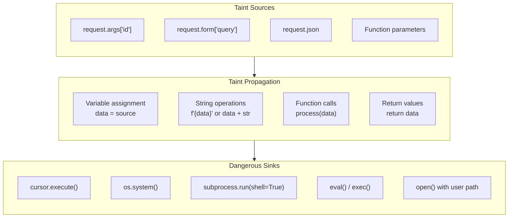
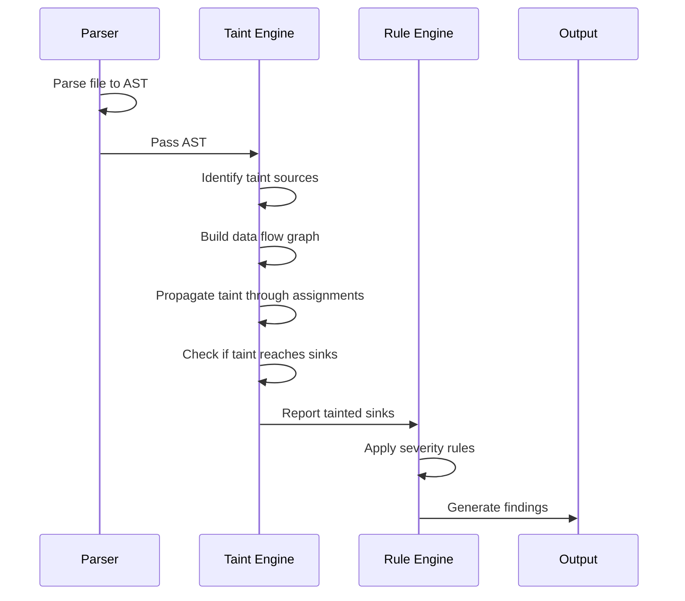

:::info
  **Enable security scanning:** `skylos . --danger` (or `--security`) for static taint, dangerous-pattern, CI/CD, and edge deployment config checks, or `skylos agent scan . --security` for the verifier-backed security taskflow. `skylos . -a` turns on `--danger` together with secrets, quality, AI-defect and dependency checks.
:::

`--danger` covers Python, TypeScript/JavaScript, Java, Go, PHP, C# and Shell.
Rust has 2 security rules and Dart has 3. There are no Kotlin security rules
yet. See [Language Support](/language-support).

## CI/CD And Edge Deployment Config Security

When run from the repository root, `skylos . --danger` scans security-relevant
configuration in addition to source code.

It reports CI/CD risks such as `pull_request_target`, broad token permissions,
unpinned third-party actions or GitLab includes, unsafe secret exposure, mutable
Docker images, template injection, OIDC release jobs that invoke
repo-controlled scripts, and missing timeouts on privileged jobs.

It also reports edge deployment risks in Docker Compose and systemd units, such
as privileged containers with device or GPU access, broad `/dev` or Docker
socket mounts, host networking on device services, root systemd services,
mutable `ExecStart` scripts, missing systemd sandboxing, and broad Linux
capabilities.

See [GitHub Actions Security](/github-actions-security) for workflow examples
and the full rule scope.

### Reading the Output

```
──────────────────────────────── Security ────────────────────────────────
┏━━━━━━━━┳━━━━━━━━━━┳━━━━━━━━━━━━━━━┳━━━━━━━━━━━━━━━━━━━━━━━━━━━━━━━━━━━━━━━━━━━━━━┳━━━━━━━━━━━━━━┓
┃ Type   ┃ Severity ┃ Rule          ┃ Message                                       ┃ Location     ┃
┡━━━━━━━━╇━━━━━━━━━━╇━━━━━━━━━━━━━━━╇━━━━━━━━━━━━━━━━━━━━━━━━━━━━━━━━━━━━━━━━━━━━━━╇━━━━━━━━━━━━━━┩
│ Review │ CRITICAL │ SQL injection │ Possible SQL injection: tainted or            │ api/db.py:11 │
│        │          │ SKY-D211      │ string-built query.                           │              │
│        │          │               │ Static source: request data                   │              │
│        │          │               │ `request.args.get`                            │              │
│        │          │               │ Static sink: SQL text passed to .execute()    │              │
│        │          │               │ Guards not observed: parameterized SQL binding│              │
│        │          │               │ Symbol: handle_query                          │              │
└────────┴──────────┴───────────────┴───────────────────────────────────────────────┴──────────────┘
```

| Column | Meaning |
|--------|---------|
| **Type** | `Defect` when the evidence is strong, `Review` when a person should check it |
| **Severity** | Risk level: Critical > High > Medium > Low |
| **Rule** | The vulnerability type with its rule ID (e.g. SKY-D211) |
| **Message** | What was found, the recorded source and sink, guards Skylos did not see, and the enclosing symbol |
| **Location** | `file:line` where the issue occurs |

To replay the recorded steps of one finding, use
[`skylos explain`](#explain-a-finding).

## Security Taskflow Audit

`skylos agent scan . --security` adds a repo-aware review path on top of Skylos's static security engine. It calls an LLM, so it needs `pip install "skylos[llm]"` and a provider key (or a local model):

- `repo_map` builds repo context, entrypoint hints, trust boundaries, and framework-aware file facts
- `audit` performs whole-file security review with explicit sources, sinks, and guards in prompt context
- `verify` re-reviews surviving findings and records evidence such as `hypothesis`, `review_supported`, and `refuted`
- an internal candidate ledger keeps stable finding IDs across stages so later reporting can build on the same evidence model

### Example

```python
from fastapi import FastAPI, Request
from urllib.parse import urlparse
import httpx

app = FastAPI()

@app.get("/proxy")
async def proxy(request: Request):
    target = request.query_params.get("url")
    return httpx.get(target).text

@app.get("/safe")
async def safe_proxy(request: Request):
    target = request.query_params.get("url")
    if urlparse(target).netloc not in {"internal.local"}:
        target = "https://internal.local/health"
    return httpx.get(target).text
```

```bash
skylos agent scan . --security --format json -o security.json
```

```json
{
  "findings": [
    {
      "rule_id": "SKY-D216",
      "severity": "critical",
      "message": "Possible SSRF: tainted URL passed to HTTP client.",
      "location": {
        "file": "app.py",
        "line": 10
      },
      "symbol": "proxy",
      "metadata": {
        "security_evidence": "review_supported",
        "review_verdict": "SUPPORTED",
        "review_reason": "challenge pass resolved the SSRF flow"
      }
    }
  ],
  "summary": "Found 1 issues: 1 critical"
}
```

The same run writes taskflow artifacts under `.skylos/runs/<run-id>/`:

- `repo_map.json`
- `candidates.json`
- `verified.json`
- `summary.json`

## Why Pattern Matching Fails

Most security scanners use regex patterns to find dangerous code. This approach has a fundamental flaw: **it can't follow data flow.**


**What Pattern Matchers See:**

    ```python
    # Caught
    cursor.execute("SELECT * FROM users WHERE id = " + user_id)
    
    # Missed
    def get_user(user_id):
        query = build_query(user_id)
        return db.execute(query)
    
    def build_query(uid):
        return f"SELECT * FROM users WHERE id = {uid}"
    ```
    
    Pattern matchers only see the `execute()` call with a variable—they can't tell if that variable contains user input.
  
**What Skylos Sees:**

    ```python
    # Skylos traces the full data flow:
    
    def get_user(user_id): # Tainted: function parameter
        query = build_query(user_id)  # Tainted: uses tainted value
        return db.execute(query) # ALERT: tainted value reaches sink
    
    def build_query(uid):  # Tainted: parameter from tainted caller
        return f"SELECT * FROM users WHERE id = {uid}"  # Tainted string
    ```
    
    Skylos follows the taint through every assignment and function call.
  
---

## How Taint Analysis Works

Skylos builds a data flow graph for each file, tracking how values propagate from **sources** (user input) to **sinks** (dangerous functions).



### The Analysis Pipeline



---

## Vulnerability Categories

### SQL Injection

:::warning
  **Severity: CRITICAL** — Attackers can read, modify, or delete your entire database.
:::

Skylos detects SQL injection across multiple frameworks:

| Framework | Dangerous Pattern | Rule ID |
|-----------|------------------|---------|
| Raw Python | `cursor.execute(f"...{user_input}...")` | SKY-D211 |
| SQLAlchemy | `session.execute(text(f"...{user_input}..."))` | SKY-D217 |
| Django ORM | `Model.objects.raw(f"...{user_input}...")` | SKY-D217 |
| Pandas | `pd.read_sql(f"...{user_input}...", conn)` | SKY-D217 |

<details>
<summary>See detection in action</summary>

```python
# Vulnerable - Skylos catches all of these

# Direct concatenation
cursor.execute("SELECT * FROM users WHERE id = " + user_id)

# F-string interpolation  
cursor.execute(f"SELECT * FROM users WHERE id = {user_id}")

# .format() method
cursor.execute("SELECT * FROM users WHERE id = {}".format(user_id))

# SQLAlchemy text()
from sqlalchemy import text
session.execute(text(f"SELECT * FROM t WHERE x = {val}"))

# Django raw()
User.objects.raw(f"SELECT * FROM users WHERE name = '{name}'")
```

```python
# Safe - parameterized queries
cursor.execute("SELECT * FROM users WHERE id = %s", (user_id,))
session.execute(text("SELECT * FROM t WHERE x = :val"), {"val": val})
User.objects.raw("SELECT * FROM users WHERE name = %s", [name])
```
</details>

### Command Injection

:::warning
  **Severity: CRITICAL** — Attackers can execute arbitrary commands on your server.
:::

<details>
<summary>See detection in action</summary>

```python
# Vulnerable
os.system(f"convert {user_filename} output.pdf")
subprocess.run(f"echo {user_input}", shell=True)

# Safe - use list arguments, no shell
subprocess.run(["convert", user_filename, "output.pdf"])
subprocess.run(["echo", user_input])  # shell=False by default
```
</details>

### Server-Side Request Forgery (SSRF)

:::warning
  **Severity: CRITICAL** — Attackers can access internal services or cloud metadata.
:::

```python
# Vulnerable - user controls the URL
requests.get(user_provided_url)

# Attacker provides: http://169.254.169.254/latest/meta-data/
# -> Accesses AWS instance metadata, potentially leaking credentials
```

Skylos also checks Java and Go SSRF patterns. Java coverage includes servlet
input flowing into `URL.openStream()` / `openConnection()`, Java
`HttpRequest` builders, and typed `RestTemplate` URL calls. Go coverage
includes direct `http.Get` style calls and `http.NewRequest*` construction.

### Path Traversal

```python
# Vulnerable
open(f"uploads/{user_filename}", "r")

# Attacker provides: ../../../etc/passwd
# -> Reads sensitive system files
```

### Cross-Site Scripting (XSS)

```python
# Vulnerable - user content rendered as HTML
from markupsafe import Markup
return Markup(f"<div>{user_comment}</div>")
```

---

## Dangerous Function Detection

Beyond taint analysis, Skylos flags inherently dangerous patterns:

| Function | Risk | Rule ID | Severity |
|----------|------|---------|----------|
| `eval()` | Arbitrary code execution | SKY-D201 | HIGH |
| `exec()` | Arbitrary code execution | SKY-D202 | HIGH |
| `os.system()` | OS command execution | SKY-D203 | CRITICAL (LOW for a constant command) |
| `pickle.load()` | Deserialization attack | SKY-D204 | CRITICAL |
| `pickle.loads()` | Deserialization attack | SKY-D205 | CRITICAL |
| `yaml.load()` | Code execution without SafeLoader | SKY-D206 | HIGH |
| `hashlib.md5()` | Weak cryptographic hash | SKY-D207 | MEDIUM |
| `hashlib.sha1()` | Weak cryptographic hash | SKY-D208 | MEDIUM |
| `subprocess.*(..., shell=True)` | Shell command execution | SKY-D209 | HIGH |
| `requests.get(verify=False)` | TLS verification disabled | SKY-D210 | HIGH |

---

## Webhook Signature Checks

Skylos flags webhook handlers that read inbound provider events without obvious signature verification (`SKY-D282`).

This is separate from normal auth checks: webhook endpoints are usually public, but the request still needs to prove it came from the provider.

```python
# Vulnerable - trusts the webhook JSON body directly
@app.post("/stripe/webhook")
async def stripe_webhook(request):
    event = await request.json()
    grant_credits(event["data"]["object"]["customer"])

# Safer - verifies the provider signature first
@app.post("/stripe/webhook")
async def stripe_webhook(request):
    body = await request.body()
    sig = request.headers.get("stripe-signature")
    event = stripe.Webhook.construct_event(body, sig, STRIPE_WEBHOOK_SECRET)
```

The check is intentionally conservative: it requires webhook/provider evidence, POST handling, request body usage, and no strong verification signal such as provider signature helpers or HMAC comparison.

---

## Explain A Finding

`skylos explain` replays the static steps Skylos recorded for a security
finding, from source to sink. It reads a saved JSON report. It runs none of
your code.

```bash
skylos . --danger --format json -o report.json
skylos explain report.json --rule SKY-D211
```

```text
SKY-D211
api/db.py:11
Possible SQL injection: tainted or string-built query.
Recorded static trace: source_to_sink. Runtime behavior was not executed or verified.
[1/7] source api/db.py:9: Imported Flask request input call: flask.request.args.get
[2/7] assignment api/db.py:9: Assignment provides: uid
...
[7/7] sink api/db.py:11: Static finding location: SKY-D211
```

Narrow it with `--rule`, `--file`, `--line` or `--finding N` (the Nth match).
`--interactive` steps through the trace with next, back and source.
`--format json` prints the trace for scripts.

---

## Secret Detection

:::info
  **Enable secret scanning:** `skylos . --secrets`
:::

`--secrets` reads Python, TypeScript/JavaScript, Go, PHP (`.php` files),
Kotlin, Rust, Dart, C#, and config files such as YAML, JSON, TOML and `.env`.
It does not read `.java` files: Java secrets (`SKY-S101`) are reported by
`--danger`, so use `-a` or add `--danger`. Shell scripts, Dockerfiles and C++
files are not scanned for secrets.

Skylos detects hardcoded credentials that should never be in source code:

| Provider | What's Detected | Example Pattern |
|----------|-----------------|-----------------|
| AWS | Access keys | `AKIA...` |
| GitHub | Personal access tokens | `ghp_...`, `gho_...` |
| Slack | Bot and user tokens | `xoxb-...`, `xoxp-...` |
| Stripe | Live API keys | `sk_live_...`, `rk_live_...` |
| Generic | Common variable names | `api_key = "..."`, `password = "..."` |

```
──────────────────────────────── Secrets ────────────────────────────────
┏━━━━━━━━┳━━━━━━━━━━┳━━━━━━━━━━━━━━━━━┳━━━━━━━━━━━━━━━━━━━━━━━━━━━━━━━━━━┳━━━━━━━━━━━━━┓
┃ Type   ┃ Severity ┃ Rule            ┃ Message                          ┃ Location    ┃
┡━━━━━━━━╇━━━━━━━━━━╇━━━━━━━━━━━━━━━━━╇━━━━━━━━━━━━━━━━━━━━━━━━━━━━━━━━━━╇━━━━━━━━━━━━━┩
│ Review │ CRITICAL │ Secret detected │ Potential stripe secret detected │ config.py:2 │
│        │          │ SKY-S101        │ Provider: stripe                 │             │
│        │          │                 │ Preview: sk_l…EFGH               │             │
└────────┴──────────┴─────────────────┴──────────────────────────────────┴─────────────┘
```

| Field | Meaning |
|--------|---------|
| **Provider** | The service the secret belongs to (e.g. AWS, Stripe, GitHub) or "generic" for high-entropy strings |
| **Message** | Description of the detected credential |
| **Preview** | A masked snippet: the first and last few characters only |
| **Location** | `file:line` where the secret was found |

---

## Comparison: Skylos vs. Other Tools

| Capability | Skylos | Bandit | Semgrep | Snyk Code |
|------------|--------|--------|---------|-----------|
| Taint analysis | Yes | No | Yes | Yes |
| Framework awareness | Yes | No | Partial | Yes |
| Dead code detection | Yes | No | No | No |
| Quality metrics | Yes | No | No | No |
| AI-powered fixes | Yes (`skylos[llm]` and your model key) | No | Paid tier | Yes |
| Runs locally | Yes | Yes | Yes | No |
| Free | Yes | Yes | Partial | Partial |

---

## Integration Example

Block PRs with critical security issues:

```yaml
# .github/workflows/security.yml
name: Security Scan

on: [pull_request]

jobs:
  skylos-security:
    runs-on: ubuntu-latest
    steps:
      - uses: actions/checkout@v4
      - uses: actions/setup-python@v5
        with:
          python-version: '3.11'
      
      - run: pip install skylos
      
      - name: Security Scan
        run: skylos . --danger --secrets --gate
```

The gate fails on any CRITICAL security finding and on any secret. That rule
cannot be turned off. Other limits come from `[tool.skylos.gate]`; see
[Quality Gate](/quality-gate).

---

## Next Steps


  ### [Rules Reference](/rules-reference)
    See all security rules with examples
  
  ### [Quality Gate](/quality-gate)
    Configure thresholds to block deployments
  
