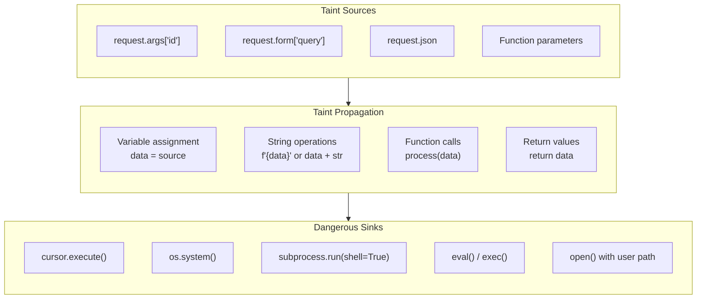
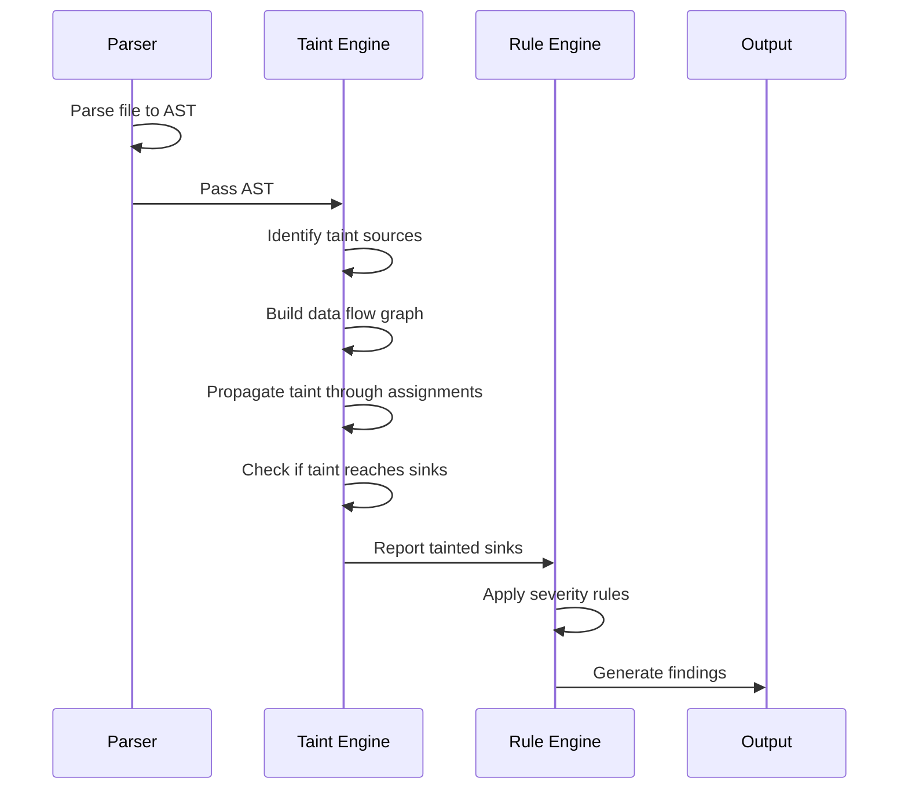

:::info
  **Enable security scanning:** `skylos . --danger` for static taint, dangerous-pattern, CI/CD, and edge deployment config checks, or `skylos agent scan . --security` for the verifier-backed security taskflow.
:::

## CI/CD And Edge Deployment Config Security

When run from the repository root, `skylos . --danger` scans security-relevant
configuration in addition to source code.

It reports CI/CD risks such as `pull_request_target`, broad token permissions,
unpinned third-party actions or GitLab includes, unsafe secret exposure, mutable
Docker images, template injection, OIDC release jobs that invoke
repo-controlled scripts, and missing timeouts on privileged jobs.

It also reports edge deployment risks in Docker Compose and systemd units, such
as privileged containers with device or GPU access, broad `/dev` or Docker
socket mounts, host networking on device services, root systemd services,
mutable `ExecStart` scripts, missing systemd sandboxing, and broad Linux
capabilities.

See [GitHub Actions Security](/github-actions-security) for workflow examples
and the full rule scope.

### Reading the Output

```
───────────────────── Security Issues ─────────────────────
 #  Issue                    Severity   Message                              Location          Symbol
 1  SQL injection            Critical   SQL injection: tainted input         api/db.py:45      handle_query
    SKY-D211
 2  Command injection        High       Command injection (shell=True)       utils/run.py:23   execute_cmd
    SKY-D212
```

| Column | Meaning |
|--------|---------|
| **Issue** | The vulnerability type with its rule ID (e.g. SKY-D211) |
| **Severity** | Risk level: Critical > High > Medium > Low |
| **Message** | What was found and why it's dangerous |
| **Location** | `file:line` where the issue occurs |
| **Symbol** | The function or scope containing the vulnerable code |

## Security Taskflow Audit

`skylos agent scan . --security` adds a repo-aware review path on top of Skylos's static security engine:

- `repo_map` builds repo context, entrypoint hints, trust boundaries, and framework-aware file facts
- `audit` performs whole-file security review with explicit sources, sinks, and guards in prompt context
- `verify` re-reviews surviving findings and records evidence such as `hypothesis`, `review_supported`, and `refuted`
- an internal candidate ledger keeps stable finding IDs across stages so later reporting can build on the same evidence model

### Example

```python
from fastapi import FastAPI, Request
from urllib.parse import urlparse
import httpx

app = FastAPI()

@app.get("/proxy")
async def proxy(request: Request):
    target = request.query_params.get("url")
    return httpx.get(target).text

@app.get("/safe")
async def safe_proxy(request: Request):
    target = request.query_params.get("url")
    if urlparse(target).netloc not in {"internal.local"}:
        target = "https://internal.local/health"
    return httpx.get(target).text
```

```bash
skylos agent scan . --security --format json -o security.json
```

```json
{
  "findings": [
    {
      "rule_id": "SKY-D216",
      "severity": "critical",
      "message": "Possible SSRF: tainted URL passed to HTTP client.",
      "location": {
        "file": "app.py",
        "line": 10
      },
      "symbol": "proxy",
      "metadata": {
        "security_evidence": "review_supported",
        "review_verdict": "SUPPORTED",
        "review_reason": "challenge pass resolved the SSRF flow"
      }
    }
  ],
  "summary": "Found 1 issues: 1 critical"
}
```

The same run writes taskflow artifacts under `.skylos/runs/<run-id>/`:

- `repo_map.json`
- `candidates.json`
- `verified.json`
- `summary.json`

## Why Pattern Matching Fails

Most security scanners use regex patterns to find dangerous code. This approach has a fundamental flaw: **it can't follow data flow.**


**What Pattern Matchers See:**

    ```python
    # Caught
    cursor.execute("SELECT * FROM users WHERE id = " + user_id)
    
    # Missed
    def get_user(user_id):
        query = build_query(user_id)
        return db.execute(query)
    
    def build_query(uid):
        return f"SELECT * FROM users WHERE id = {uid}"
    ```
    
    Pattern matchers only see the `execute()` call with a variable—they can't tell if that variable contains user input.
  
**What Skylos Sees:**

    ```python
    # Skylos traces the full data flow:
    
    def get_user(user_id): # Tainted: function parameter
        query = build_query(user_id)  # Tainted: uses tainted value
        return db.execute(query) # ALERT: tainted value reaches sink
    
    def build_query(uid):  # Tainted: parameter from tainted caller
        return f"SELECT * FROM users WHERE id = {uid}"  # Tainted string
    ```
    
    Skylos follows the taint through every assignment and function call.
  
---

## How Taint Analysis Works

Skylos builds a data flow graph for each file, tracking how values propagate from **sources** (user input) to **sinks** (dangerous functions).



### The Analysis Pipeline



---

## Vulnerability Categories

For Rust, run `skylos . --danger` from the crate or workspace root. The Rust checks follow request data into supported SQL, command, filesystem, HTML and HTTP calls. They also cover disabled TLS verification, exposed credentials and selected cryptographic APIs. The [Rust guide](/rust-support#reading-a-rust-finding) shows how to check a reported call and which paths the scanner follows.

### SQL Injection

:::warning
  **Severity: CRITICAL** — Attackers can read, modify, or delete your entire database.
:::

Skylos detects SQL injection across multiple frameworks:

| Framework | Dangerous Pattern | Rule ID |
|-----------|------------------|---------|
| Raw Python | `cursor.execute(f"...{user_input}...")` | SKY-D210 |
| SQLAlchemy | `session.execute(text(f"...{user_input}..."))` | SKY-D217 |
| Django ORM | `Model.objects.raw(f"...{user_input}...")` | SKY-D217 |
| Pandas | `pd.read_sql(f"...{user_input}...", conn)` | SKY-D217 |

<details>
<summary>See detection in action</summary>

```python
# Vulnerable - Skylos catches all of these

# Direct concatenation
cursor.execute("SELECT * FROM users WHERE id = " + user_id)

# F-string interpolation  
cursor.execute(f"SELECT * FROM users WHERE id = {user_id}")

# .format() method
cursor.execute("SELECT * FROM users WHERE id = {}".format(user_id))

# SQLAlchemy text()
from sqlalchemy import text
session.execute(text(f"SELECT * FROM t WHERE x = {val}"))

# Django raw()
User.objects.raw(f"SELECT * FROM users WHERE name = '{name}'")
```

```python
# Safe - parameterized queries
cursor.execute("SELECT * FROM users WHERE id = %s", (user_id,))
session.execute(text("SELECT * FROM t WHERE x = :val"), {"val": val})
User.objects.raw("SELECT * FROM users WHERE name = %s", [name])
```
</details>

### Command Injection

:::warning
  **Severity: CRITICAL** — Attackers can execute arbitrary commands on your server.
:::

<details>
<summary>See detection in action</summary>

```python
# Vulnerable
os.system(f"convert {user_filename} output.pdf")
subprocess.run(f"echo {user_input}", shell=True)

# Safe - use list arguments, no shell
subprocess.run(["convert", user_filename, "output.pdf"])
subprocess.run(["echo", user_input])  # shell=False by default
```
</details>

### Server-Side Request Forgery (SSRF)

:::warning
  **Severity: CRITICAL** — Attackers can access internal services or cloud metadata.
:::

```python
# Vulnerable - user controls the URL
requests.get(user_provided_url)

# Attacker provides: http://169.254.169.254/latest/meta-data/
# -> Accesses AWS instance metadata, potentially leaking credentials
```

Skylos also checks Java, Go, and Rails SSRF patterns. Java coverage includes
servlet input flowing into URL calls, `HttpRequest` builders, and typed
`RestTemplate` calls. The Go engine can follow request data into a directly
resolved helper in another file of the same buildable package. In Rails,
Skylos checks whether controller input can choose the destination of a
supported outbound HTTP call. Review which part of the URL the input controls.

### Path Traversal

```python
# Vulnerable
open(f"uploads/{user_filename}", "r")

# Attacker provides: ../../../etc/passwd
# -> Reads sensitive system files
```

### Cross-Site Scripting (XSS)

```python
# Vulnerable - user content rendered as HTML
from markupsafe import Markup
return Markup(f"<div>{user_comment}</div>")
```

### Weak RSA keys in Python

- A Django mail app can let each domain choose a key size for signing email. If a domain leaves it blank, the app uses the default.
- If that default is 1024 bits and the app uses it to create a key with OpenSSL, Skylos flags the line that sets the default. It can follow the setting across Python files.
- Set the default to at least 2048 bits for new keys. [See rule SKY-D383](./rules-reference#sky-d383).

---

## Dangerous Function Detection

Beyond taint analysis, Skylos flags inherently dangerous patterns:

| Function | Risk | Rule ID | Severity |
|----------|------|---------|----------|
| `eval()` | Arbitrary code execution | SKY-D201 | HIGH |
| `exec()` | Arbitrary code execution | SKY-D202 | HIGH |
| `pickle.load()` | Deserialization attack | SKY-D204 | CRITICAL |
| `pickle.loads()` | Deserialization attack | SKY-D205 | CRITICAL |
| Unsafe YAML loaders in Python and Ruby | The loader can build objects from YAML data | SKY-D206 | HIGH or MEDIUM |
| `hashlib.md5()` | Weak cryptographic hash | SKY-D207 | MEDIUM |
| `hashlib.sha1()` | Weak cryptographic hash | SKY-D208 | MEDIUM |
| TLS verification settings for supported clients | The client may accept an untrusted certificate or hostname | SKY-D210 | HIGH |

---

## Review security settings across languages

Run `skylos . --danger --format json` from the repository root. Use the rule
ID and reported line to find the setting or call, then check where it is used.

### Connections, encryption, and XML

- **TLS.** Skylos checks selected ways to disable verification in Python,
  TypeScript and JavaScript, Go, Java, Rust, Dart, and PHP. Keep certificate
  and hostname checks on. Configure a trusted CA for private certificates.
  In Python, [SKY-D430](./rules-reference#sky-d430) also flags explicit TLS
  1.0, TLS 1.1, or older SSL settings. Use a minimum of TLS 1.2 or newer.
- **SSH.** [SKY-D380](./rules-reference#sky-d380) checks Python Paramiko and
  Go SSH client settings that accept unknown host keys. Load trusted host
  keys and reject unexpected ones.
- **Encryption.** [SKY-D384](./rules-reference#sky-d384) checks explicit
  ECB selection in supported Python and Kotlin cipher calls. Use an
  authenticated encryption mode such as AES-GCM with a fresh nonce for each
  encryption.
- **XML.** In C#, SKY-D236 reports an `XmlReader` call when its effective
  settings allow DTD parsing and use a URL resolver. Review the settings used
  at the parse call. Prohibit DTDs and keep the resolver null when the
  application does not need external resources.

### Browser, Spring, and Swift apps

- **Browser messages.** [SKY-D431](./rules-reference#sky-d431) checks
  supported browser Window messages. Use an exact target origin when sending
  data. Check `event.origin` before incoming data reaches a sensitive action.
- **Spring Boot.** [SKY-D432](./rules-reference#sky-d432) flags wildcard
  Actuator exposure in application YAML and properties files, including
  profile-specific files. List the endpoints each profile needs and review
  who can reach them in the deployed app.
- **Spring Security.** [SKY-D433](./rules-reference#sky-d433) checks Java
  configurations that disable CSRF protection. Keep it on for routes where
  browsers attach credentials automatically, including routes that use
  session cookies.
- **Swift.** [SKY-D434](./rules-reference#sky-d434) checks writes with
  credential-like keys or values in Foundation `UserDefaults`. Use the
  Keychain for tokens and passwords.

### C++ buffers and memory

- [SKY-D435](./rules-reference#sky-d435) checks calls such as `sprintf`
  and `strcpy` that write without a capacity argument. Use a managed string
  or use an API that takes the destination capacity and handle truncation.
- [SKY-D436](./rules-reference#sky-d436) checks for repeated frees and
  [SKY-D437](./rules-reference#sky-d437) checks accesses after free.
  Skylos follows visible allocations and simple aliases in one straight-line
  block. Use an owning container or RAII wrapper to manage the lifetime.

---

## Webhook Signature Checks

Skylos flags webhook handlers that read inbound provider events without obvious signature verification (`SKY-D282`).

This is separate from normal auth checks: webhook endpoints are usually public, but the request still needs to prove it came from the provider.

```python
# Vulnerable - trusts the webhook JSON body directly
@app.post("/stripe/webhook")
async def stripe_webhook(request):
    event = await request.json()
    grant_credits(event["data"]["object"]["customer"])

# Safer - verifies the provider signature first
@app.post("/stripe/webhook")
async def stripe_webhook(request):
    body = await request.body()
    sig = request.headers.get("stripe-signature")
    event = stripe.Webhook.construct_event(body, sig, STRIPE_WEBHOOK_SECRET)
```

The check is intentionally conservative: it requires webhook/provider evidence, POST handling, request body usage, and no strong verification signal such as provider signature helpers or HMAC comparison.

---

## Secret Detection

:::info
  **Enable secret scanning:** `skylos . --secrets`
:::

Skylos detects hardcoded credentials that should never be in source code:

| Provider | What's Detected | Example Pattern |
|----------|-----------------|-----------------|
| AWS | Access keys | `AKIA...` |
| GitHub | Personal access tokens | `ghp_...`, `gho_...` |
| Slack | Bot and user tokens | `xoxb-...`, `xoxp-...` |
| Stripe | Live API keys | `sk_live_...`, `rk_live_...` |
| Generic | Common variable names | `api_key = "..."`, `password = "..."` |

```
──────────────────────── Secrets ────────────────────────
 #  Provider  Message                    Preview           Location
 1  aws       AWS Access Key detected    AKIA****EXAMPLE   config.py:12
 2  stripe    Stripe Live Key detected   sk_live_****xyz   payments.py:8
```

| Column | Meaning |
|--------|---------|
| **Provider** | The service the secret belongs to (e.g. AWS, Stripe, GitHub) or "generic" for high-entropy strings |
| **Message** | Description of the detected credential |
| **Preview** | A masked snippet of the secret |
| **Location** | `file:line` where the secret was found |

---

## Comparison: Skylos vs. Other Tools

| Capability | Skylos | Bandit | Semgrep | Snyk Code |
|------------|--------|--------|---------|-----------|
| Taint analysis | ✅ | ❌ | ✅ | ✅ |
| Framework awareness | ✅ | ❌ | Partial | ✅ |
| Dead code detection | ✅ | ❌ | ❌ | ❌ |
| Quality metrics | ✅ | ❌ | ❌ | ❌ |
| AI-powered fixes | ✅ | ❌ | ❌ | ✅ |
| Self-hosted | ✅ | ✅ | ✅ | ❌ |
| Free | ✅ | ✅ | Partial | Partial |

---

## Integration Example

Block PRs with critical security issues:

```yaml
# .github/workflows/security.yml
name: Security Scan

on: [pull_request]

jobs:
  skylos-security:
    runs-on: ubuntu-latest
    steps:
      - uses: actions/checkout@v4
      - uses: actions/setup-python@v5
        with:
          python-version: '3.11'
      
      - run: pip install skylos
      
      - name: Security Scan
        run: skylos . --danger --secrets --gate
```

With `fail_on_critical = true` (default), any CRITICAL finding blocks the PR.

---

## Next Steps


  ### [Rules Reference](/rules-reference)
    See all security rules with examples
  
  ### [Quality Gate](/quality-gate)
    Configure thresholds to block deployments
  
